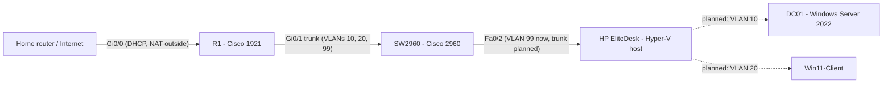

# Home Lab: Cisco Networking + Windows Server

A hands-on lab built to practice the skills from my B.S. in Cloud and Network Engineering at WGU: VLANs, trunking, inter-VLAN routing, NAT, and Windows Server infrastructure (Active Directory, DHCP, Group Policy).

**Author:** Alexander Lewis | **Status:** In progress (see checklist below)

---

## Equipment

| Device | Role |
|---|---|
| Cisco 1921 router (IOS 15.7) | Inter-VLAN routing (router-on-a-stick), NAT/PAT, DHCP relay |
| Cisco WS-C2960-24TC-L (IOS 12.2(55)SE4) | Layer 2 access switch, VLANs, trunk |
| Cisco 3750 (IOS 12.2(44)SE4) | Reserved for Stage 2 (STP, EtherChannel, Layer 3 SVIs) |
| HP EliteDesk 800 G4 Mini (i5-8500T, 16 GB RAM, 256 GB NVMe) | Hyper-V host for the Windows Server and Windows 11 VMs |

All devices were configured over console cable using PuTTY (9600 baud, 8N1).

## Topology

Solid lines are built and tested. Dashed lines are planned.

## Addressing and VLANs

| VLAN | Name | Subnet | Gateway (R1) |
|---|---|---|---|
| 10 | SERVERS | 10.10.10.0/24 | 10.10.10.1 |
| 20 | USERS | 10.10.20.0/24 | 10.10.20.1 |
| 99 | MGMT | 10.10.99.0/24 | 10.10.99.1 |

| Host | Address |
|---|---|
| SW2960 management | 10.10.99.3 |
| HP EliteDesk (host) | 10.10.99.10 |
| DC01 (planned) | 10.10.10.10 |
| DHCP pool, VLAN 20 (planned) | 10.10.20.100 - 10.10.20.200 |

I used 10.10.x.x so the lab can never overlap with the 192.168.x.x home network behind it.

## Project Checklist

- [x] Base device hardening: SSH only, local users, encrypted passwords, banner
- [x] VLANs 10/20/99 and 802.1Q trunk between router and switch
- [x] Router-on-a-stick inter-VLAN routing
- [x] NAT (PAT overload) to the home network, verified with internet access from the HP
- [ ] Hyper-V host setup and virtual switch with VLAN tagging
- [ ] Windows Server 2022: AD DS, DNS
- [ ] DHCP server with relay (`ip helper-address`) across VLANs
- [ ] PowerShell script: 5 OUs and 150 users
- [ ] Windows 11 client joined to the domain, authentication and connectivity tests
- [ ] Group Policy and Cisco security hardening (port security, ACLs)
- [ ] Remote access (RRAS VPN)
- [ ] Stage 2: add the 3750 (STP, EtherChannel, SVIs)

## Key Configuration Concepts

- **Router-on-a-stick:** one physical router port (Gi0/1) split into 802.1Q subinterfaces, one per VLAN, each acting as that VLAN's default gateway.
- **PAT:** `ip nat inside source list NAT_INSIDE interface gi0/0 overload` translates all inside addresses to the router's WAN address.
- **DHCP relay:** DHCP discovery is a broadcast, so `ip helper-address` on the VLAN 20 subinterface forwards it as a unicast to the DHCP server in VLAN 10.
- **VLAN tagging for VMs:** the switch port facing the Hyper-V host is a trunk, and each VM's virtual NIC is tagged to its VLAN with `Set-VMNetworkAdapterVlan`.

Sanitized device configs are in [`configs/`](configs/).

## Troubleshooting Log

### Case 1: Host could reach the switch but not the router

**Symptom:** The HP could ping the 3750's management address but not its gateway (R1), while the 3750 itself could reach the internet through R1.

**Diagnosis:**
1. Verified HP IP settings, route table, and ARP table (`ipconfig /all`, `route print`, `arp -a`). No ARP entry for the gateway.
2. Ran `debug arp` on R1. R1 received every ARP request from the HP and sent a reply.
3. Captured traffic in Wireshark on the HP. Its requests went out, but R1's replies never arrived.
4. Read the switch's interface counters and found R1's frames arriving on the uplink but almost nothing forwarded to the HP's port.
5. Ruled out, one at a time: native VLAN tagging, trunk vs. access mode, SPAN sessions, VLAN filters, ACLs, static MAC entries, and a bad switch port (the problem followed the HP to a different port).

**Outcome:** I removed the 3750 from the path and rebuilt with only the router and a 2960 from a clean config. The HP then had full connectivity. The 3750 is the likely cause, but I did not confirm a root cause on it. I plan to revisit it in Stage 2 after a full reset.

**Lessons:** Change one variable at a time, capture packets at both ends of a link, and simplify the topology early instead of stacking more tests onto a complex one. Stacked-switch numbering (`Fa2/0/x` after a used switch kept its old stack member number) was also a good reminder to check interface names with `show ip interface brief` before copying configs.

### Case 2: Locked out of a switch

**Symptom:** After configuring `login local` on the console without creating a user, I could not log in.

**Fix:** Password recovery using the Mode button (`flash_init`, rename `config.text`, boot, restore the config). **Prevention:** run `show running-config | include username` before closing any session.

## Screenshots

Add images to [`screenshots/`](screenshots/) and link them here, for example:

- `ping-8.8.8.8-from-hp.png`: HP reaching the internet through R1 NAT
- `show-vlan-brief.png`: VLANs on SW2960
- `show-ip-nat-translations.png`: PAT in action

## Notes

- Windows Server and Windows 11 use Microsoft evaluation ISOs, which are not stored in this repository.
- All credentials in this repository are placeholders or redacted. This is a lab-only environment.

## Next Steps

1. Build the Hyper-V virtual switch and DC01.
2. Install AD DS, DNS, and DHCP, then create the 5 OUs and 150 users with PowerShell.
3. Join a Windows 11 client to the domain and verify authentication.
4. Apply Group Policy and network hardening.
5. Add the 3750 for STP and EtherChannel practice.
