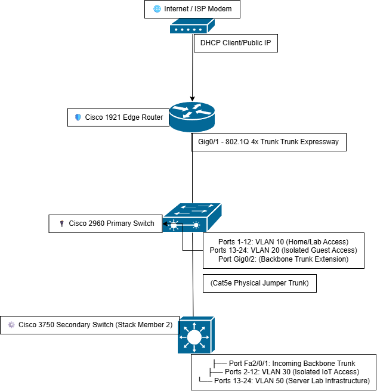

# 🛠️ Enterprise Homelab Network Infrastructure

## 1. Home / Dashboard (The "Hook")

### 🌐 The Big Picture
This homelab is a production-grade, sandboxed network infrastructure built from the ground up using enterprise-grade Cisco hardware. The objective of this project is to master fundamental and advanced concepts in **Layer 2 switching, Layer 3 routing, stateful packet filtering (firewalls), and network segmentation**. 

By moving away from consumer "plug-and-play" gear, this environment mirrors enterprise network architectures, providing hands-on validation for real-world business infrastructure, security policies, and performance engineering.

### 📊 Current State & Topology Specs
*   **Infrastructure Model:** Multi-Switch Layer 2 Access / Layer 3 Border Core Architecture (Router-on-a-Stick).
*   **Logical Networks Hosted:** 4 Fully Isolated Virtual LANs (VLANs) segmenting endpoint traffic classes.
*   **State:** 🟢 Active / Live Production

### 🗺️ Network Architecture Diagram

